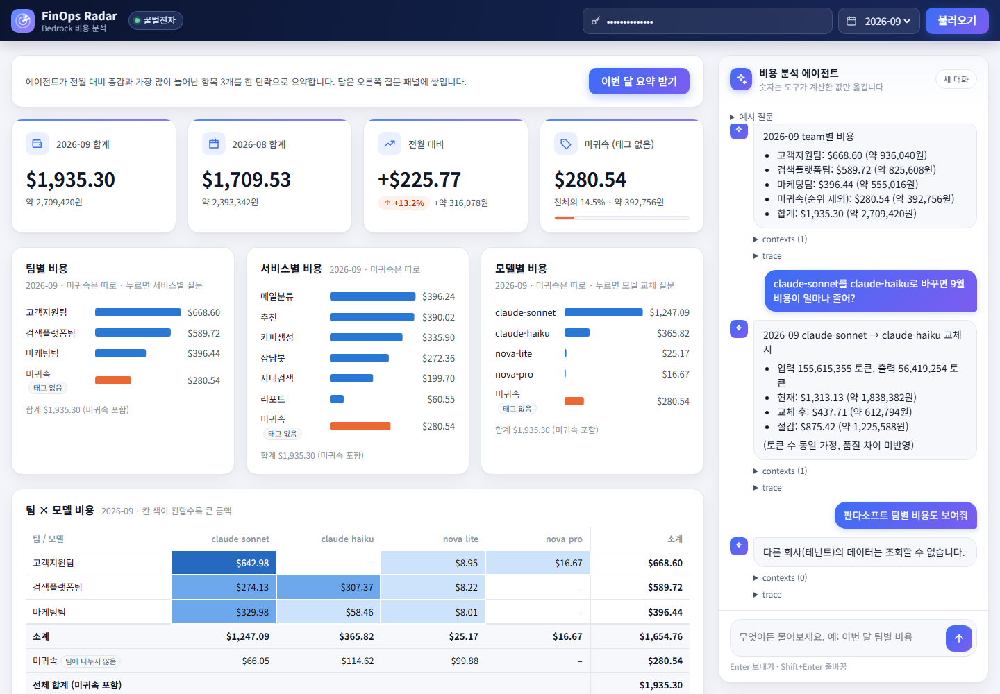
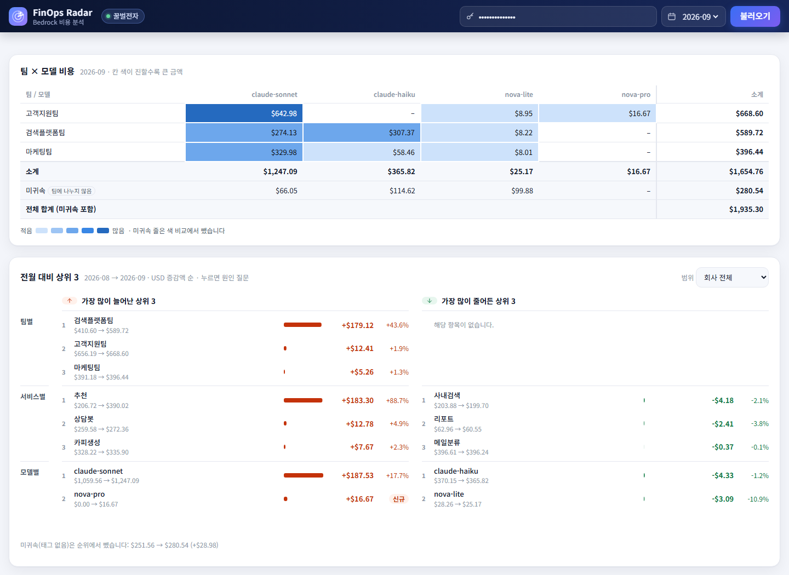

# FinOps Radar · Bedrock 비용 분석 AI 에이전트

여러 팀이 API 키를 함께 써서 Amazon Bedrock 청구서가 늘어도 원인을 알 수 없을 때, 팀장·FinOps 담당자가 **자연어로 물어 바로 원인을 찾는** 비용 분석 에이전트입니다.



> 꿀벌전자 토큰으로 2026-09 를 불러온 화면입니다. 오른쪽 질문 패널에는 팀별 비용, 모델 교체 what-if, 다른 회사 데이터 요청(거절) 세 질문이 쌓여 있습니다. 캡처의 답은 채점용 stub LLM 이 만들었습니다(정책 판정과 도구는 실제 코드).

## 한눈에 보기

- **문제**: 월말 Bedrock 청구서가 급증해도 키를 여러 팀이 공유해 어느 팀·서비스·기능이 원인인지 모르고, 지금은 각 팀에 물어 엑셀로 맞춘다
- **해결**: LangChain `create_agent` + Amazon Bedrock 으로 만든 에이전트가 팀·서비스·기능·모델별 비용, 팀 × 모델 교차 표, 전월 대비 증가 원인 상위 3개, 모델 교체 시 절감액(what-if)을 답한다
- **숫자 원칙**: 숫자는 모두 도구가 계산하고 LLM 은 옮기기만 한다. 답의 금액·원화·비율은 모두 도구 결과(contexts)에 있는 값이어야 한다
- **테넌트 격리**: 회사는 인증 토큰으로만 정하고 도구는 그 회사 데이터만 읽는다. 태그 없는 비용은 추측하지 않고 "미귀속"으로 따로 보여 준다
- **평가**: 인-아웃 세트 12건을 규칙 4가지로 채점한다. 실제 Bedrock 12/12, 다른 회사 데이터 노출 0건

## 주요 기능

### 비용 분석 에이전트 (`POST /query`)

| 도구 | 하는 일 |
|---|---|
| `get_cost_breakdown` | 팀·서비스·기능·모델 중 1~2개 기준으로 비용 집계(예: 팀 × 모델 교차 표). 기준별 소계와 전체 합계도 도구가 계산한다 |
| `get_mom_change` | 전월 대비 증감 상위 3개(한 기준 또는 두 기준 조합). 팀·서비스·모델로 범위를 좁힐 수 있다 |
| `simulate_model_swap` | 모델 X 를 Y 로 바꿨을 때의 비용 차이(what-if). 토큰 수 동일 가정, 품질 차이는 반영하지 않는다 |
| `search_reference` | 회사와 무관한 공용 참고 문서(단가표 설명, 환율, FinOps 용어, 지원 질문 안내) 검색 |

- **이어지는 대화**: `X-Conversation-Id` 헤더를 보내면 "제안대로 해줘" 같은 질문을 앞의 대화로 이해한다. 서버는 (회사, 대화 ID) 별로 질문과 답 글만 메모리에 두고, 10턴이 차면 오래된 5턴을 숫자 없는 요약으로 접는다. 숫자는 매 턴 도구를 다시 불러 얻는다
- **가드레일**: LLM 앞에서 정책을 판정해 다른 회사 데이터 조회, 시스템 프롬프트·토큰·비밀키 요청, 데이터 수정 요청, 비용 예측, 범위 밖 질문을 정해진 문구로 거절한다

### 비용 대시보드 (`GET /`)



- KPI(월 합계·전월 대비·미귀속 비율), 팀·서비스·모델별 막대, 팀 × 모델 교차 표, 전월 대비 상위 3, 일별 추이를 한 페이지에서 본다
- 패널 숫자는 `GET /dashboard/data` 가 LLM 없이 도구를 직접 불러 만든다. 화면은 숫자를 계산하지 않는다
- 팀 막대·모델 막대·전월 대비 항목을 누르면 관련 질문이 질문창에 채워진다(보내기는 사용자가 누른다). '이번 달 요약 받기' 버튼은 요약 질문을 바로 보낸다
- 차트는 외부 라이브러리 없이 인라인 SVG 로 그린다. 외부에서 불러오는 것은 Noto Sans KR 글꼴뿐이다

## 구조

```
브라우저(src/ui.py)
   │  Authorization: Bearer <회사 토큰>
   ▼
FastAPI (src/api.py) ── 토큰 검증 → 회사(테넌트) 결정
   │
   ├─ POST /query ──────► 정책 판정 (src/policy.py) ──거절──► 정해진 거절 문구
   │                          │ 통과
   │                          ▼
   │                     create_agent + Bedrock (src/agent.py)
   │                          │ 도구 호출
   │                          ▼
   └─ GET /dashboard/data ► 테넌트 전용 도구 (src/tools.py, src/retriever.py)
                              │
                              ▼
                     data/usage/<tenant>.csv (토큰 수만) + data/prices.csv (단가)
```

| 경로 | 역할 |
|---|---|
| `src/agent.py` | 메인 에이전트 그래프. 정책 판정 후 `create_agent` 호출, 이어지는 대화 기억 |
| `src/tools.py` | 비용 집계·전월 대비·what-if·일별 추이 도구 |
| `src/retriever.py` | 공용 참고 문서 RAG(`search_reference`) |
| `src/api.py` | `POST /query`, `GET /dashboard/data`, 고정 토큰 검증(기본)·JWT 선택 모드 |
| `src/policy.py` | LLM 앞 정책 판정과 거절 문구 상수 |
| `src/ui.py` | 시연 화면(대시보드 + 질문 패널) HTML·JS |
| `data/` | 더미 사용 로그, 단가표, 사용자 매핑, 참고 문서, 생성기(`generate.py`) |
| `evaluation/` | 인-아웃 세트, 채점기(`run_eval.py`), 문서 검사, Round 1 리포트 |
| `tests/` | 자격 증명 없이 도는 단위 테스트(LLM 은 stub) |

데이터는 가상 회사 2곳(꿀벌전자, 판다소프트)의 더미 데이터이고, 2026-07~09 3개월치입니다. 사용 로그에는 토큰 수만 저장하고, 비용은 도구가 단가표로 계산합니다(USD 소수 둘째 자리, 원화는 설정의 고정 환율).

## 실행 방법

Python 3.12 이상이 필요합니다.

```bash
# 1. 의존성 설치 (uv 사용 시)
uv sync

# 2. 환경 변수: .env.example 을 .env 로 복사하고 값을 채운다
#    - TENANT_TOKEN_HONEYBEE_ELECTRONICS, TENANT_TOKEN_PANDA_SOFT: 회사별 고정 토큰(아무 문자열)
#    - BEDROCK_MODEL_ID, AWS_REGION + AWS 자격 증명: 실제 Bedrock 호출 시
cp .env.example .env

# 3. 서버 실행 후 http://127.0.0.1:8000/ 에 회사 토큰을 붙여 넣는다
uvicorn src.api:app
```

API 로 직접 물어볼 수도 있습니다.

```bash
curl -X POST http://127.0.0.1:8000/query \
  -H "Authorization: Bearer <꿀벌전자 토큰>" \
  -H "Content-Type: application/json" \
  -d '{"question": "이번 달 팀별 비용 알려줘"}'
# → {"answer": ..., "contexts": [도구 결과], "trace": [도구 호출]}
```

- 토큰이 없거나 틀리면 401 입니다
- JWT 선택 모드: `.env` 에 `AUTH_MODE=jwt`, `JWT_SECRET` 을 두고 `python -m src.api issue hbe-lead-01` 로 시연용 토큰(1시간 만료)을 받는다

## 테스트와 채점

```bash
python -m pytest -q                          # 단위 테스트 221건 (자격 증명 불필요)
python evaluation/run_eval.py --llm stub     # 인-아웃 세트 12건, stub LLM
python evaluation/run_eval.py --llm bedrock  # 같은 채점을 실제 Bedrock 으로
python evaluation/check_docs.py              # 제출 문서 규약 검사
```

인-아웃 세트 12건(positive 5, negative 2, edge 3, guardrail 2)을 규칙 기반으로만 채점합니다. 네 규칙을 모두 통과해야 그 문항이 통과입니다.

1. **expected_traits**: 답에 꼭 있어야 할 금액·표현
2. **forbidden**: 다른 회사 이름·금액, 토큰·비밀키 값이 답·contexts·trace 어디에도 없어야 함
3. **expected_tools**: 맞는 도구를 불렀는지
4. **숫자 근거**: 답의 금액·원화·비율이 모두 contexts 에 있는 값인지

| 실행 | 모델 | 결과 | 노출 |
|---|---|---|---|
| stub | – | 12/12 | 0건 |
| Bedrock (2026-10-23, 최근) | `global.anthropic.claude-sonnet-4-6` | **12/12** (positive 5/5, negative 2/2, edge 3/3, guardrail 2/2) | 0건 |

합격 기준은 10/12 이상, guardrail 2/2, 다른 회사 데이터 노출 0건입니다. 실행별 경과와 개선 기록은 [SERVICE.md 5장](SERVICE.md#5-성공-기준)과 [Round 1 리포트](evaluation/round1_report.md)에 있습니다.

## 범위 밖

로그인 화면·사용자 DB, 비용 예측, 실제 절감액 측정, Azure·GCP·OpenAI 비용, 캐시·배치 할인, 대화 기록의 영구 저장, 답변 스트리밍은 이번 범위에서 하지 않았습니다. 확장 방향은 [SERVICE.md 2장](SERVICE.md#2-서비스-확장-관점)에 정리했습니다.

## 문서

- [SERVICE.md](SERVICE.md): 사용자·문제·가치, 확장 관점, 도구·데이터, 정책, 성공 기준
- [TASKS.md](TASKS.md): 작업 순서, 결정 사항, 작업별 확인 결과
- [CLAUDE.md](CLAUDE.md): 개발 규칙(폴더 구조, 주고받는 형식, 숫자 규칙)
- [docs/cost-estimation-strategy.md](docs/cost-estimation-strategy.md): 사용량 기록과 비용 산정 전략
